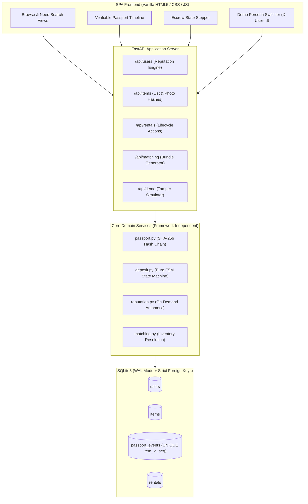

# 📦 RENTX (Buy Nothing, Rent Everything)

> **Campus-first peer-to-peer equipment borrowing marketplace with verifiable item passports, simulated escrow state machine, multidimensional reputation, and need-based bundling.**

---

## 🎯 The Problem

College students and dorm residents frequently need high-utility equipment for short periods—such as power drills to mount shelves, high-lumen projectors for watch parties, carbon-fiber tripods for photoshoots, or tents for weekend trips. However:
1. **High ownership friction:** Equipment is expensive, bulky, and sits idle 95% of the year.
2. **The Counterparty Trust Deficit:** Peer lending fails because lenders fear equipment damage or theft, while borrowers lack collateral transparency.
3. **Intent-to-Inventory Mismatch:** Students search by *intent* ("we are camping in Yosemite") rather than knowing specific model numbers or hardware tags.

---

## 💡 The Solution

**RentAll** creates a hyper-local campus sharing network built on three pillars:
- **Verifiable Item Passport:** Every asset receives an immutable, append-only SHA-256 cryptographic provenance chain tracking condition checklists, owners, and rental returns. Any physical alteration or database tampering is mathematically detected in real-time.
- **Deterministic Escrow State Machine:** A pure-Python finite state machine (`pending` → `held` → `released` / `disputed` → `resolved`) that simulates smart contract escrow collateral without cryptocurrency gas or fiat payment friction.
- **Multidimensional Reputation:** Transparent, on-demand scoring evaluating both **Renter** (return punctuality %, item care %) and **Owner** (reliability %, response latency, dispute rate) roles.
- **Need-Based Bundling:** Translates conversational intent into curated packages with real-time campus inventory matching.

---

## 🏗️ Architecture



---

## 🚀 Setup & Run in 3 Commands

### 1. Install dependencies
```bash
pip install -r requirements.txt
```

### 2. Seed demo database (Creates 6 campus personas, 15 verified items, and rental histories)
```bash
python seed.py
```

### 3. Launch the development server
```bash
uvicorn app.main:app --reload
```

Open your browser at **`http://127.0.0.1:8000`** (or `/static/index.html`).

---

## 🧪 Running the Automated Test Suite

RentAll includes 16 unit and end-to-end integration tests:
```bash
pytest -v
```

---

## 🎬 5-Step Presentation Demo Script

Follow this 5-minute walkthrough during live hackathon demos:

### Step 1: List Equipment & Inspect Hash Generation
1. Switch demo persona to **Maya Lin** (top-right dropdown).
2. Navigate to **➕ List Equipment**.
3. Fill in:
   - **Title:** `Aputure 300W Studio Strobe Light`
   - **Category:** `Camera Gear` (note how the inspection checklist dynamically adapts to *lens, body, battery, memory card*).
   - **Daily Fee:** `$20`, **Deposit:** `$50`, **Serial:** `APU-300-PRO`.
4. Click **🔐 Register & Compute Cryptographic Passport**.
5. Observe the created item and its genesis block #1 with SHA-256 hash.

### Step 2: Need Search & Package Resolution
1. Navigate to **✨ Need Search**.
2. Type: `"going camping this weekend with friends"` (or click the quick template).
3. Observe how the natural language intent matches the **Weekend Camping Trip** package:
   - Matches available **Tent**, **Stove**, **Lantern**, and **Sleeping Bag**.
   - Displays combined daily rate and total escrow deposit.

### Step 3: Request & Accept (Escrow Hold)
1. Switch demo persona to **Jordan Lee** (Renter).
2. Go to **🔍 Browse**, select the **Sony Alpha A7 IV** (or any available tool), and click **Borrow**.
3. Select **3 days** and submit the request.
4. Switch persona to the item's owner (**Maya Lin**).
5. Go to **📋 My Rentals** → **🏠 As Owner**.
6. Click **✓ Accept & Lock Escrow**.
7. Observe the Escrow Stepper transition from `Pending` → `Held in Escrow` and the item becoming unavailable.

### Step 4: Return, Inspection Rating & Escrow Release
1. Switch back to **Jordan Lee** (Renter) → **📋 My Rentals** → **🎒 As Renter**.
2. Click **📦 Initiate Return**.
3. Switch back to **Maya Lin** (Owner) → **📋 My Rentals** → **🏠 As Owner**.
4. Click **✓ Confirm Return & Rate** → Grade **5 Stars (Excellent)**.
5. Observe the Escrow Stepper transition to `Released` and the item becoming available again.
6. Navigate to **👤 Reputation** to see Jordan's 100% Punctuality and 5.0 Star Care metrics update immediately.

### Step 5: Item Passport & Live Tamper Test
1. Navigate to **🔍 Browse** → Click **🛡️ Passport** on any item.
2. Observe the green banner: `🛡️ Cryptographic Integrity Verified (All SHA-256 block hashes match)`.
3. Scroll through the vertical timeline showing Block #1 (Registered), Block #2 (Rented), Block #3 (Returned).
4. Click the red button: **⚡ Demo: Tamper Event #2**.
5. The banner immediately turns bright red:
   > 🚨 **TAMPER DETECTED: Chain Broken at Event #2**
   > *Cryptographic hash mismatch! Direct database tampering or record manipulation was detected.*

---

## 📊 Feature Fidelity Matrix (Built vs. Simulated vs. Vision)

| Feature Module | Status | Implementation Details |
| :--- | :--- | :--- |
| **Item Passport & Provenance** | **BUILT (REAL)** | Real SHA-256 cryptographic hashing over image bytes, composite hardware serials, and append-only hash chains. Mathematical verification recomputes links from Genesis block #1. No external blockchain node required. |
| **Deposit State Machine** | **SIMULATED** | Deterministic pure-Python finite state machine (`pending` → `held` → `released` / `disputed` → `resolved`). Simulates escrow collateral without real fiat banking or crypto token movement. |
| **Multidimensional Reputation** | **BUILT (REAL)** | Computed on-demand directly from rental history across both Renter (punctuality %, care %) and Owner (reliability %, response latency, dispute count) dimensions. Zero-division safe. |
| **Need-Based Matching** | **BUILT (HONEST)** | Tokenized keyword normalization matching natural language project intents to required tool dependencies with real-time inventory resolution and missing item alerts. |
| **Social Trust Graph & Multi-Campus** | **VISION ONLY** | Social graph vouching, campus federations, and emergency tool routing are future architectural visions. |

---

## 📐 Architectural Design Decisions

1. **Why SQLite (stdlib `sqlite3`) with per-request transactions?**
   - Eliminates heavy ORM overhead and complex migrations.
   - Enforces `PRAGMA foreign_keys = ON;` and `BEGIN IMMEDIATE` transaction locking so concurrent passport block writes can never fork sequence numbers.
2. **Why a Framework-Independent State Machine?**
   - `services/deposit.py` has zero dependencies on FastAPI or HTTP libraries.
   - The state transition matrix (`VALID_DEPOSIT_TRANSITIONS`) maps 1:1 to an Escrow Smart Contract (e.g. Solidity / EVM) interface.
3. **Demo-Only Authentication Header (`X-User-Id`):**
   - For rapid hackathon evaluation, authentication uses a dropdown persona switcher that passes `X-User-Id` in request headers, storing state in `localStorage` without password friction.

---

## 🛠️ Configuration

The application name and branding can be changed in a single constant in [`app/config.py`](file:///app/config.py):
```python
APP_NAME = "Buy Nothing, Rent Everything"
```
